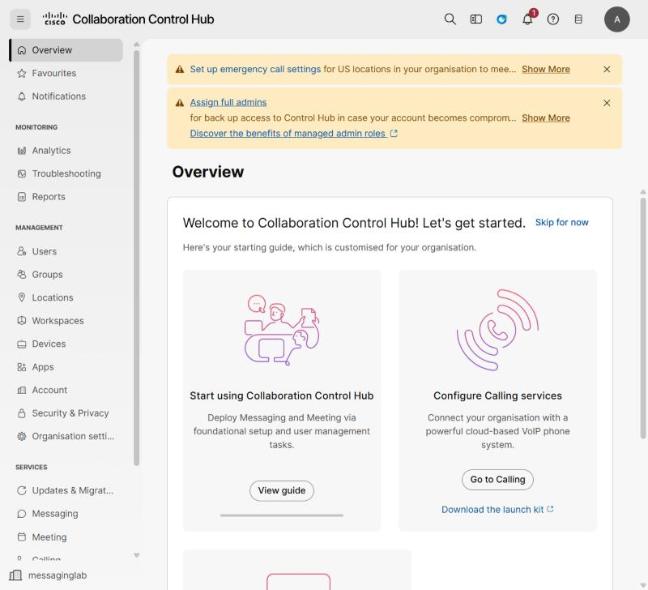
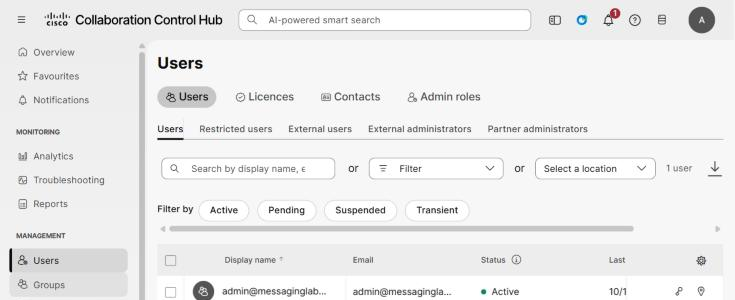
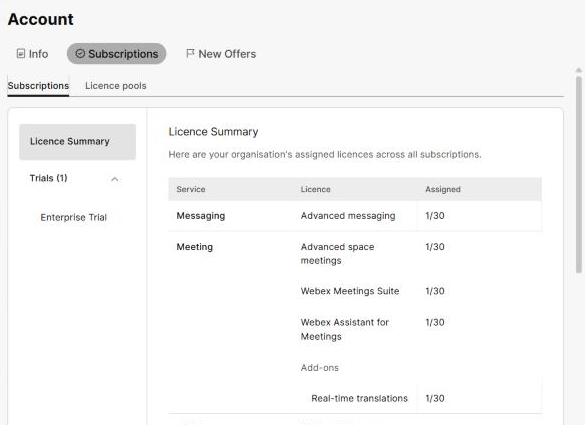

# Task 1 – Prerequisites & Sign In to Control Hub

<span class="task-badge">Task 1 of 7</span> &nbsp; **Estimated time:** 5 minutes

In this task you confirm you have everything the lab needs, then sign in to Control Hub
— the web console where Webex organizations are administered.

## Before you begin

You need all of the following.

| Requirement | Details |
| --- | --- |
| **A Webex organization** | A paid subscription, a trial, or a [developer sandbox organization](https://developer.webex.com/docs/developer-sandbox-guide). |
| **Full administrator rights** | Your account must hold the **Full administrator** role in that organization. A read-only administrator cannot add users. |
| **At least one free Webex Messaging license** | Check this in Step 4 below. |
| **A second email address** | For the new user. It must not already belong to a Webex account. |
| **A device for the new user** | A second computer, a phone, or a private/incognito browser window. |
| **Webex App installed** | Download from [webex.com/downloads](https://www.webex.com/downloads.html), or plan to use the browser client at [web.webex.com](https://web.webex.com). |

!!! tip "No second mailbox? Use a plus-address"
    Most mail systems (Gmail, Microsoft 365, and others) deliver mail sent to
    `yourname+lab1@example.com` into the `yourname@example.com` inbox, while Webex
    treats it as a completely separate identity. That gives you a usable second user
    without asking IT for a mailbox.

    Confirm your mail system supports this by sending yourself a test message to the
    plus-address **before** you create the Webex user.

!!! warning "Do not reuse an address that already has Webex"
    Control Hub will refuse an email address that already belongs to another Webex
    organization or to a free Webex account — including a free trial someone signed up
    for themselves. If that happens, see [Troubleshooting](troubleshooting.md#email-already-exists).

## Choose your lab identities

Write these down now. You will use them in every remaining task.

| Placeholder | Your value | Example |
| --- | --- | --- |
| `<admin-email>` | ______________________ | `pat.admin@example.com` |
| `<new-user-email>` | ______________________ | `pat.admin+lab1@example.com` |
| `<new-user-first>` | ______________________ | `Jordan` |
| `<new-user-last>` | ______________________ | `Lee` |

## Steps

### Step 1 — Open Control Hub

In a browser, go to:

```text
https://admin.webex.com
```

### Step 2 — Sign in as the administrator

Enter `<admin-email>`, click **Sign In**, and complete your organization's
authentication (password, SSO, and/or multi-factor prompt).

!!! note "First sign-in to a new organization"
    The first time anyone signs in to a brand-new organization, Control Hub may show a
    **Review our Terms of Service** dialog, a **Review your organisation profile** form,
    and a cookie banner. Accept the terms (you cannot continue without them). The
    profile form can be closed with **X** and completed later.

### Step 3 — Confirm you landed in the right organization

Look at the **bottom of the left navigation**. It shows the name of the organization
you are managing (`messaginglab` in the screenshots in this lab).



If the navigation is collapsed to icons, click the **≡** menu at the top left to expand
it. If you administer more than one organization, click the organization name and
switch to the one you intend to use for this lab.

!!! warning "Check this twice"
    Everything you do in the next six tasks happens in whichever organization is
    selected here. Adding a lab user to a production tenant by mistake is annoying to
    undo.

### Step 4 — Confirm you have a free Messaging license

1. In the left navigation, under **Management**, click **Users**. You see the user
   list with tabs for **Users**, **Licences**, **Contacts**, and **Admin roles**.

    

2. In the left navigation, under **Management**, click **Account**, then the
   **Subscriptions** tab.
3. The **Licence Summary** lists every licence across your subscriptions. Find the
   **Messaging** row — in a trial organization the licence is called
   **Advanced messaging**.
4. Read the **Assigned** column, shown as *assigned / total* (for example `1/30`). You
   need at least one unassigned license.



!!! note "Trial and sandbox organizations"
    Trials and developer sandboxes typically include a generous block of Messaging
    licenses, so this check usually passes without any action.

## :material-check-circle: Verify your work

Do not continue until all of these are true.

- [ ] You are signed in at `admin.webex.com`.
- [ ] The organization name at the bottom of the left navigation is the organization you intend to use.
- [ ] You can open **Management > Users** and see the existing user list.
- [ ] **Account > Subscriptions** shows at least one available Webex Messaging license.
- [ ] You have written down `<new-user-email>` and can read mail delivered to it.

---

[Next: Task 2 – Add the User :material-arrow-right:](02-add-user.md){ .md-button .md-button--primary }
