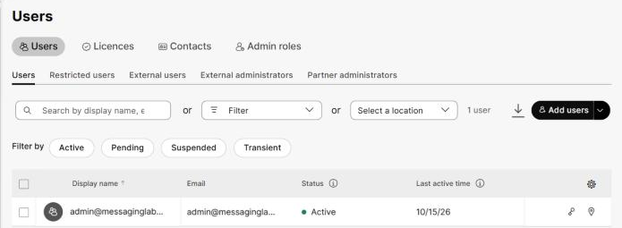
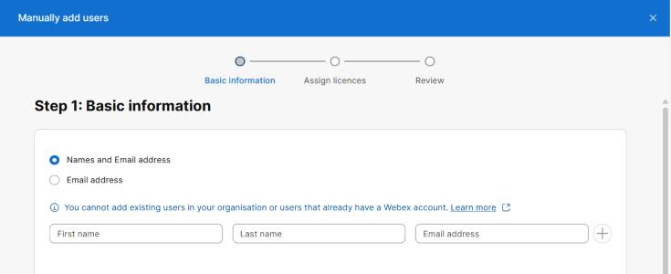
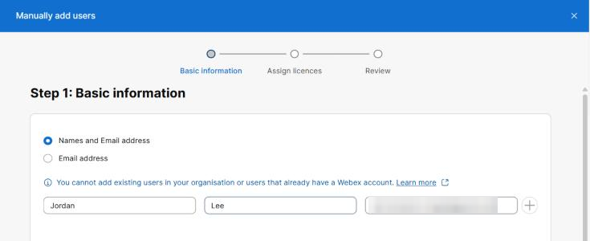
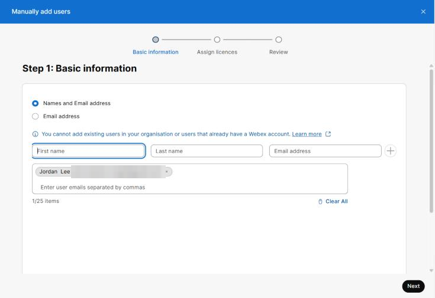

# Task 2 – Add the User

Task 2 of 7 &nbsp; **Estimated time:** 5 minutes

Now you create the account. Control Hub walks you through a three-step wizard —
**Basic information**, **Assign licences**, and **Review** — then adds the user.

!!! note "Can I add users manually?"
    Manual user creation is available when your organization is **not** synchronizing
    identities from an external directory. If your users come from Active Directory via
    Directory Connector, or from a cloud identity provider, Control Hub blocks manual
    creation and you add the user at the source instead. See
    [Troubleshooting](troubleshooting.md#add-user-is-greyed-out).

## Steps

### Step 1 — Open the user list

In Control Hub, go to **Management > Users**.

You see a table of everyone currently in the organization, with columns for display
name, email, status, and last active time. The **Add users** button is at the right,
above the table.

!!! tip "Can't see Add users?"
    In a narrow browser window the expanded left navigation can push **Add users** off
    the right edge of the page. Collapse the navigation with the **≡** menu, or widen
    the window.

### Step 2 — Start the Add users wizard

Click **Add users**.

The **Manually add users** wizard opens at **Step 1: Basic information**.

### Step 3 — Choose how to identify the user

The wizard asks how you want to enter people. Make sure this option is selected (it is
the default):

**Names and Email address**

!!! tip "Why not email-only?"
    **Email address** is the fastest option and lets you paste a comma-separated list
    — useful when you are onboarding a batch. For this lab, supplying the name gives
    you a friendlier display name to search for in Task 6, so take the slightly longer
    path.

### Step 4 — Enter the new user's details

Fill in the three fields with the values you wrote down in Task 1:

| Field | Value |
| --- | --- |
| First name | `<new-user-first>` |
| Last name | `<new-user-last>` |
| Email address | `<new-user-email>` |

Then click the **+** button at the end of the row to commit the entry.

The person appears as a chip in the list box below the form, and the counter under it
reads `1/25 items`.

!!! warning "The chip must appear in the list"
    **Next** stays disabled until at least one person has been added to the list. If
    **Next** is greyed out, you typed the details but did not click **+**.

### Step 5 — Continue to licensing

Click **Next**.

!!! note "Batch limits"
    You can add up to **25 users at a time** this way — that is what the `1/25 items`
    counter tracks. If your organization has marked any user attribute as required, the
    limit drops to **1 user at a time**. One user is all this lab needs either way.

## What just happened

Nothing yet — the wizard has only collected your input. The account is not created, and
no license is touched, until you finish the review step in Task 3. You can still cancel
safely at this point by closing the wizard with **X**.

## :material-check-circle: Verify your work

- [ ] You are in the **Manually add users** wizard.
- [ ] `<new-user-email>` appears as a chip in the list of users to add.
- [ ] The first and last name shown in the chip match what you intended.
- [ ] You clicked **Next** and are now on **Step 2: Assign licences for users**.

---

[:material-arrow-left: Back: Task 1](01-prerequisites.md){ .md-button }
[Next: Task 3 – Assign the Messaging License :material-arrow-right:](03-assign-license.md){ .md-button .md-button--primary }
