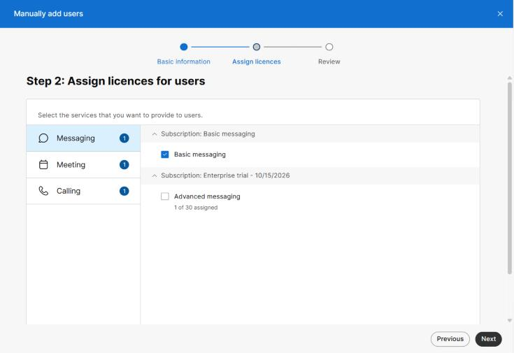
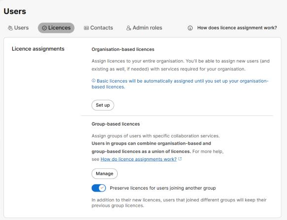
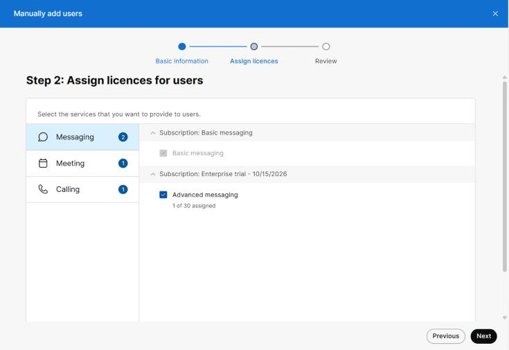
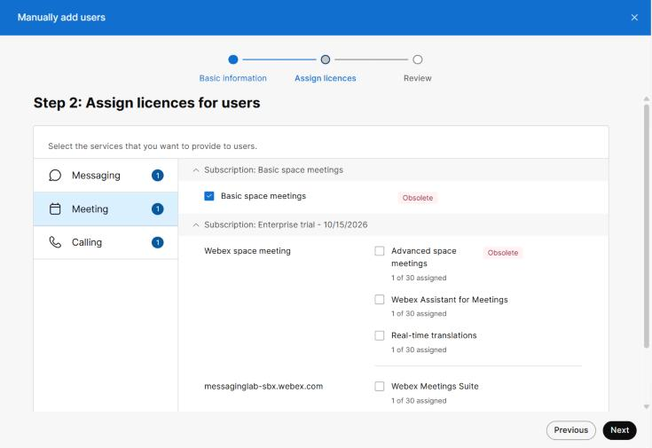
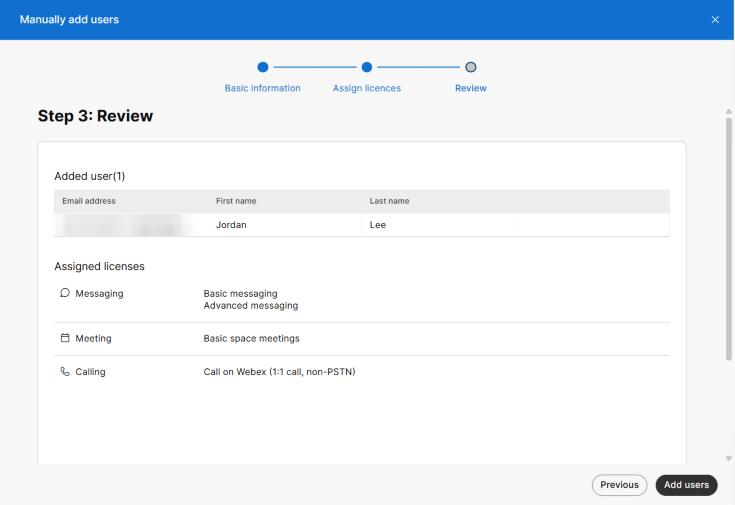
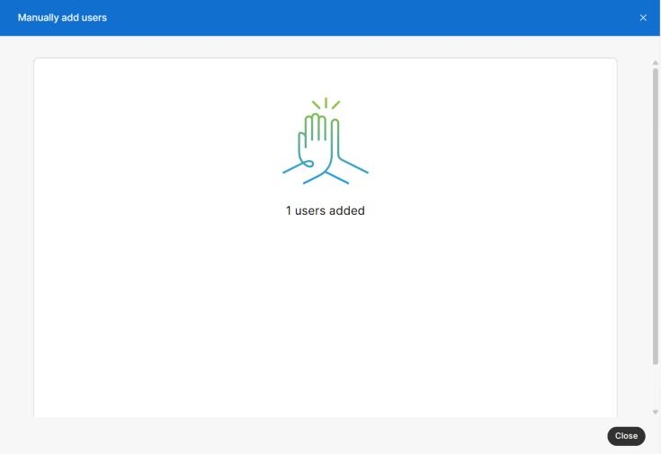

# Task 3 – Assign the Messaging License

Task 3 of 7 &nbsp; **Estimated time:** 5 minutes

A Webex user with no license can exist, but cannot do anything useful. This task grants
the Messaging service, which is what makes the Webex App usable for chat, spaces, and
file sharing.

## Understand what you are granting

| Service | What it enables | In this lab |
| --- | --- | --- |
| **Messaging** | Direct messages, spaces, file sharing, presence, whiteboards | :material-check: Required |
| **Meeting** | Hosting scheduled and personal-room meetings | Not required |
| **Calling** | PSTN / cloud calling, phone number and extension | Not required |

!!! note "Free *Basic* entitlements vs. paid licences"
    Control Hub distinguishes two kinds of entitlement:

    - **Basic** entitlements — **Basic messaging**, **Basic space meetings**, and
      **Call on Webex (1:1 call, non-PSTN)** — are free, come from their own
      no-cost subscriptions, and are not counted against your licence pool.
    - **Paid / trial licences** — such as **Advanced messaging** — come from your
      subscription and are counted (`1 of 30 assigned`).

    In this lab you assign **Advanced messaging**, the counted Messaging licence you
    checked in Task 1.

## Steps

### Step 1 — Read the licensing screen

You are now on **Step 2: Assign licences for users**. The left column lists the
services — **Messaging**, **Meeting**, and **Calling** — and the right column shows the
licences available for the selected service, grouped by subscription. The number badge
next to each service shows how many licences are ticked for it.

By default, Control Hub pre-ticks the free Basic entitlements for every service:
**Basic messaging**, **Basic space meetings**, and **Call on Webex**.

!!! note "Where do the defaults come from?"
    The defaults are controlled by the organization's licence-assignment template under
    **Management > Users > Licences**. In a new organization it reads *"Basic licences
    will be automatically assigned until you set up your organisation-based
    licences."* Organization-based and group-based templates are convenient in
    production; this lab leaves them unconfigured and chooses licences by hand.

    

### Step 2 — Choose the subscription

Each licence is listed under the subscription it comes from — for example
**Subscription: Enterprise trial - 10/15/2026**. If your organization has more than one
paid subscription, pick the licence from the subscription you confirmed had free
licences in Task 1.

### Step 3 — Select Advanced messaging

With **Messaging** selected in the left column, tick **Advanced messaging**.

Control Hub locks the Basic entitlements on (they turn grey and cannot be cleared) and
the **Messaging** badge changes to **2**.

### Step 4 — Leave Meeting and Calling at their defaults

Click **Meeting** and **Calling** in the left column to look at them, but do not tick
any of the paid licences there (**Advanced space meetings**, **Webex Meetings Suite**,
**Webex Calling – Professional**, and so on).

The free **Basic space meetings** and **Call on Webex** entitlements stay ticked and
locked. That is expected — they are included with any paid licence and cost nothing.

!!! warning "Resist the urge to tick everything"
    Ticking Meeting or Calling licences here consumes additional licences from your
    subscription and, for Calling, adds configuration (such as location and phone
    number) that this lab does not cover. Advanced messaging only.

Click **Next**.

### Step 5 — Review

**Step 3: Review** lists each user you are about to add and the licences each one will
receive.

Confirm:

- **Added user(1)** — exactly one user is listed.
- The email address is `<new-user-email>`, spelled correctly.
- **Assigned licenses** shows **Messaging: Basic messaging, Advanced messaging**,
  and only the free Basic entitlements for Meeting and Calling.

!!! tip "Last chance to fix a typo"
    After submission, correcting a misspelled email address means deleting the user and
    starting over. Use **Previous** to go back now if anything is wrong.

### Step 6 — Submit

Click **Add users**.

Control Hub creates the account and shows a confirmation reading `1 users added`.

### Step 7 — Close the wizard

Click **Close**. You return to the user list.

## :material-check-circle: Verify your work

- [ ] The review screen showed exactly one user with **Advanced messaging**.
- [ ] You clicked **Add users** and saw `1 users added`.
- [ ] You clicked **Close** and returned to the user list.
- [ ] `<new-user-email>` now appears in the **Management > Users** table.

If Control Hub reported an error instead, see
[Troubleshooting](troubleshooting.md#email-already-exists).

---

[:material-arrow-left: Back: Task 2](02-add-user.md){ .md-button }
[Next: Task 4 – Verify in Control Hub :material-arrow-right:](04-verify-user.md){ .md-button .md-button--primary }
