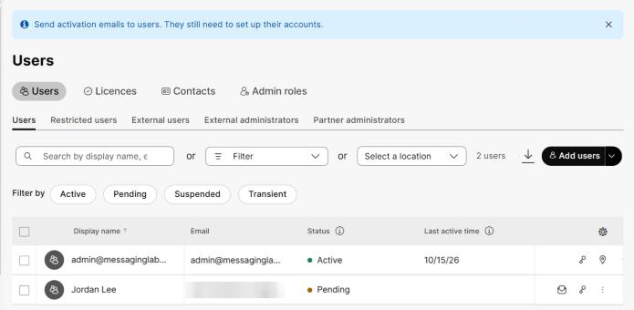
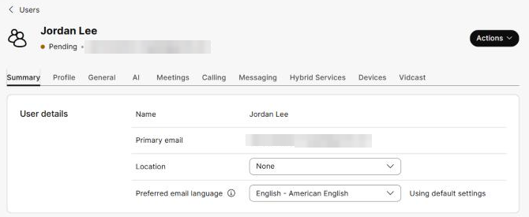
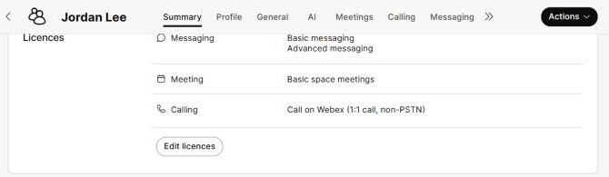

# Task 4 – Verify the User in Control Hub

Task 4 of 7 &nbsp; **Estimated time:** 5 minutes

Before you hand the account to the user, confirm from the administrator side that it
looks the way you intended. Catching a wrong license here is far cheaper than
debugging it after the user reports "Webex doesn't work."

## Steps

### Step 1 — Find the user

Go to **Management > Users**.

The new user is in the table. If the list is long, type part of `<new-user-email>` or
`<new-user-first>` in the **Search by display name, email…** box above the table.

!!! tip
    If the user does not appear, clear any active **Filter by** buttons (Active,
    Pending, Suspended, Transient) — a filter left over from earlier browsing is the
    usual cause.

### Step 2 — Read the status

Look at the **Status** column for your new user. It reads **Pending**.

You may also see a blue banner at the top of the page: *"Send activation emails to
users. They still need to set up their accounts."* The envelope icon at the right of the
user's row is **Resend Invitation**.

!!! note "What Pending means"
    **Pending** means the account exists in your organization but the person has never
    signed in. It is the expected state for a brand-new user. It becomes **Active**
    after the first successful sign-in, which you will do in Task 5.

### Step 3 — Open the user's profile

Click the user's name.

The user's profile opens as a full page. The header shows the name, status, and email
address, an **Actions** menu, and tabs: **Summary**, **Profile**, **General**,
**AI**, **Meetings**, **Calling**, **Messaging**, **Hybrid Services**, **Devices**,
and **Vidcast**.

### Step 4 — Confirm the assigned licences

On the **Summary** tab, scroll down to the **Licences** section.

Confirm:

| Service | Expected licences |
| --- | --- |
| **Messaging** | Basic messaging, **Advanced messaging** |
| **Meeting** | Basic space meetings only (free) |
| **Calling** | Call on Webex (1:1 call, non-PSTN) only (free) |

!!! tip "Fixing it here"
    **Edit licences** is also where you change a license after the fact. If Advanced
    messaging is missing, add it and save — you do not need to delete and recreate the
    user. Likewise, if an extra paid licence was assigned, clear it here.

### Step 5 — Check the invitation email

Further down the **Summary** tab, the **Info** section shows **Last email status**.

In testing, a freshly added user showed **Last email status: None** in Control Hub, yet
the invitation email still arrived at `<new-user-email>` within a minute or two. Don't
treat **None** as proof that nothing was sent — check the user's inbox.

If the user doesn't receive an email, you have two options:

| Option | What to do |
| --- | --- |
| Resend it | In **Management > Users**, click the **Resend Invitation** (envelope) icon on the user's row. |
| Skip it | The user can go straight to [web.webex.com](https://web.webex.com) or the Webex App and sign in with their address. Webex emails them a confirmation code instead (Task 5). |

!!! note "Why would an organization not email new users?"
    Large organizations often stage thousands of accounts weeks before go-live and do
    not want users activating early or filing help-desk tickets about an unexpected
    email. They send their own communication instead, on their own schedule.

## :material-check-circle: Verify your work

- [ ] `<new-user-email>` is listed under **Management > Users**.
- [ ] Their status is **Pending**.
- [ ] Their **Licences** section shows **Advanced messaging**.
- [ ] No paid Meeting or Calling licence is assigned — only the free Basic entitlements.
- [ ] You know whether the invitation email has arrived.

---

[:material-arrow-left: Back: Task 3](03-assign-license.md){ .md-button }
[Next: Task 5 – Activate & Sign In :material-arrow-right:](05-activate-signin.md){ .md-button .md-button--primary }
