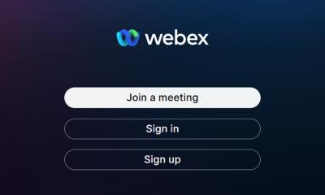
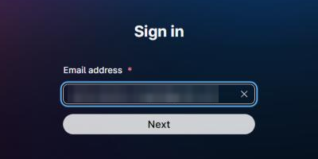
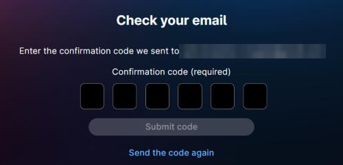
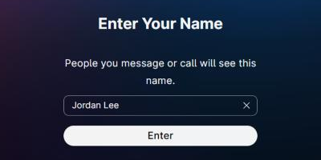
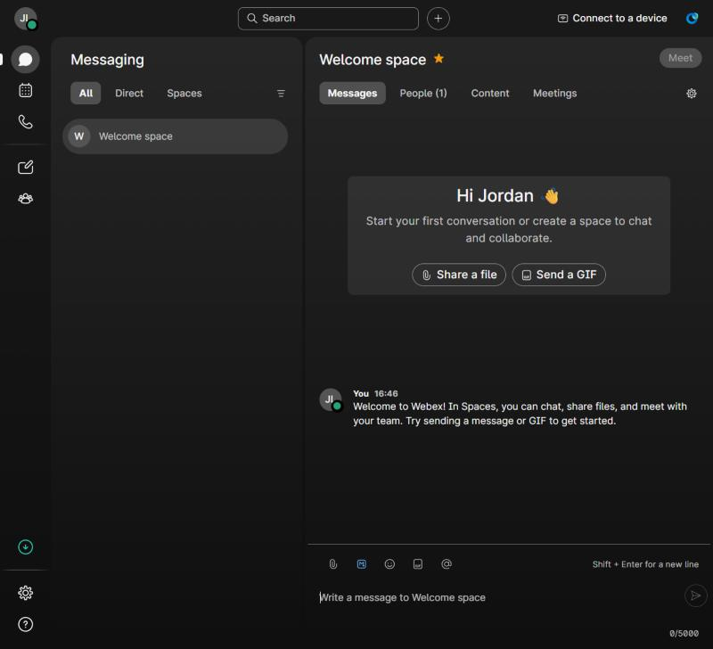
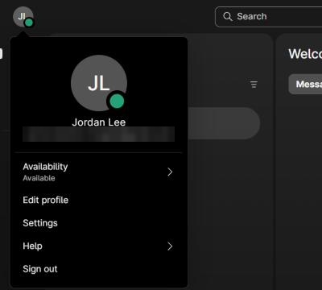
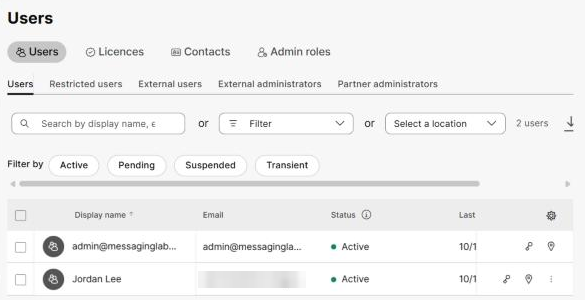
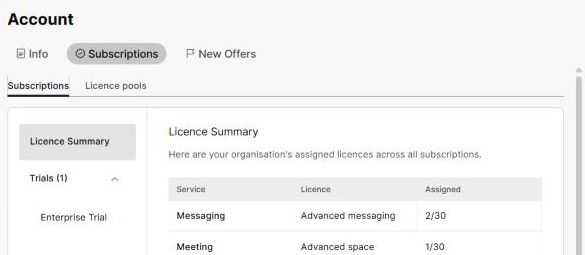

# Task 5 – Activate and Sign In to the Webex App

Task 5 of 7 &nbsp; **Estimated time:** 10 minutes

Switch roles. For this task and the next, you are the **new user**, not the
administrator.

!!! warning "Use a separate browser profile or device"
    Your administrator session is already signed in to Webex in this browser. If you
    sign the new user in to the Webex App in the same browser profile, the two Webex App
    sessions collide and you will spend ten minutes confused about who you are signed
    in as.

    Use one of these instead:

    - A **private / incognito window**
    - A **different browser** (admin in Chrome, user in Firefox)
    - A **second computer or a phone**

    Control Hub (`admin.webex.com`) and the Webex web app (`web.webex.com`) keep
    separate sessions, so the admin can stay in Control Hub in one tab while the new
    user uses the web app in another. What does *not* work is two different people in
    the **web app** in the same browser profile.

## Steps

### Step 1 — Check for the invitation email

Open the inbox for `<new-user-email>`.

Look for a message from Webex inviting the user to join the organization. It contains
a prominent button to activate the account.

??? question "No email arrived?"
    Work through these in order:

    1. **Check junk/spam.** This is the cause the majority of the time.
    2. **Wait five minutes.** Delivery is usually quick but not guaranteed.
    3. **Resend it.** As the administrator, open **Management > Users** and click the
       **Resend Invitation** (envelope) icon on the user's row.
    4. **Skip it entirely.** The email is a convenience, not a requirement. Go straight
       to Step 2 — signing in with the email address triggers a confirmation code
       instead.

    More detail in [Troubleshooting](troubleshooting.md#no-activation-email).

### Step 2 — Sign in to the Webex App as the new user

Choose the client you are using. The web app is the quickest option because there is
nothing to install, and it is the client shown in the screenshots in this lab.

!!! warning "Passwords in a lab"
    Whichever client you use, a brand-new account is asked to create a password. Use a
    throwaway password generated for this lab. Do not reuse a password from any other
    system, and do not share it in chat, tickets, or lab worksheets.

=== "Web app"

    1. In your private window, go to [web.webex.com](https://web.webex.com) and click
       **Sign in**.

        

    2. Enter `<new-user-email>` and click **Next**.

        

    3. Because the account has never been used, Webex shows **Check your email** and
       sends a six-digit confirmation code to `<new-user-email>`. Type the code into the
       six boxes and click **Submit code**. If it doesn't arrive, check junk/spam, then
       click **Send the code again**.

        

    4. Create a password that meets the complexity rules shown on screen, confirm it,
       and submit.

    5. Webex shows **Enter Your Name**, pre-filled with the first and last name the
       administrator entered in Task 2. People you message will see this name. Check it
       and click **Enter**.

        

    6. The app opens on **Messaging**. A **Welcome space** has been created
       automatically, with a *"Hi `<new-user-first>`"* banner and a welcome message.

        

    7. Click your **initials** in the top-left corner. The menu shows the display name
       and email address of the signed-in account. Confirm it reads
       `<new-user-first> <new-user-last>` and `<new-user-email>` — not your admin
       account. Press ++esc++ to close the menu.

        

=== "Desktop app"

    1. Download the installer from [webex.com/downloads](https://www.webex.com/downloads.html).
    2. Install and launch **Webex**.
    3. Choose to sign in, enter `<new-user-email>`, and continue.
    4. Follow the prompts to verify the email address and create a password. A
       brand-new account is normally asked to confirm its email address with a code
       sent to `<new-user-email>`.
    5. Confirm or enter the display name `<new-user-first> <new-user-last>` if asked.
    6. Work through the first-run experience. The app may show a short set of
       introductory tips and ask for permissions:
        - Click through or dismiss the tips.
        - Allowing notifications is helpful for Task 6, since it lets you see messages
          arrive.
        - Microphone and camera are not needed for this lab; you may decline them.
    7. Click your **profile picture or initials** and confirm the menu shows
       `<new-user-first> <new-user-last>` and `<new-user-email>` — not your admin
       account.

    !!! note "Not captured for this lab"
        The screenshots in this lab were taken in the web app. Desktop app screens
        differ in layout; follow the on-screen prompts.

=== "Mobile app"

    1. Install **Webex** from the App Store or Google Play.
    2. Launch it, choose to sign in, and enter `<new-user-email>`.
    3. Follow the prompts to verify the email address and create a password.
    4. Confirm or enter the display name `<new-user-first> <new-user-last>` if asked.
    5. Allow notifications if you want to see Task 6 messages arrive; microphone and
       camera are not needed for this lab.
    6. Open your profile and confirm it shows `<new-user-first> <new-user-last>` and
       `<new-user-email>`.

    !!! note "Not captured for this lab"
        The screenshots in this lab were taken in the web app. Mobile screens differ in
        layout; follow the on-screen prompts.

!!! note "Single sign-on (SSO) organizations"
    If your organization uses SSO, every client redirects you to your identity provider
    instead of asking for a code and password. Authenticate there as you normally
    would.

### Step 3 — Confirm the status flipped in Control Hub

Switch back to your administrator session and go to **Management > Users**.

Find the new user. Their status now reads **Active** instead of **Pending**.

!!! tip
    If it still shows Pending, refresh the page. Control Hub does not update the table
    live.

Now open **Account > Subscriptions**. The **Advanced messaging** count includes the
new user (in the screenshots, `2/30`: the administrator plus the new user).

## :material-check-circle: Verify your work

- [ ] The Webex App is open and signed in as `<new-user-email>`.
- [ ] The profile menu shows the new user's name and address, not the admin's.
- [ ] The **Messaging** area of the app is visible.
- [ ] In Control Hub, the user's status has changed from **Pending** to **Active**.

---

[:material-arrow-left: Back: Task 4](04-verify-user.md){ .md-button }
[Next: Task 6 – Exchange Messages :material-arrow-right:](06-exchange-messages.md){ .md-button .md-button--primary }
