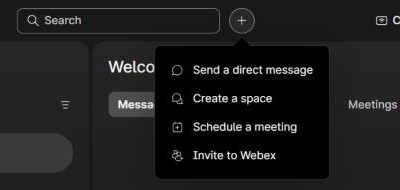
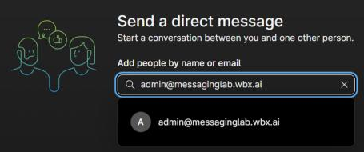
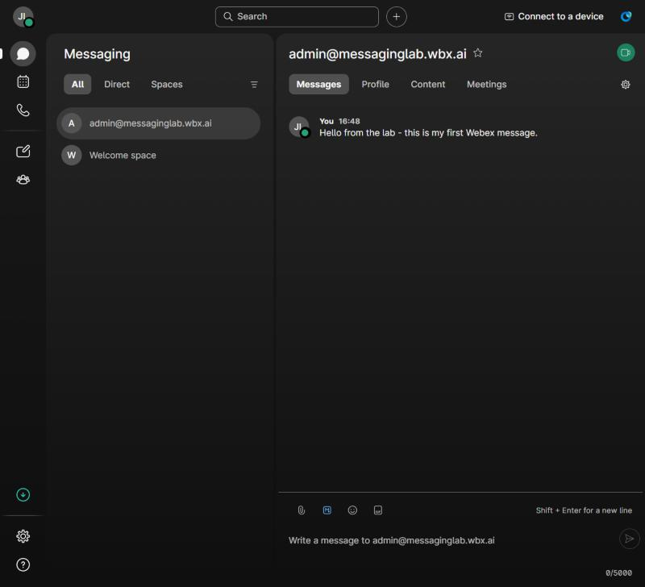
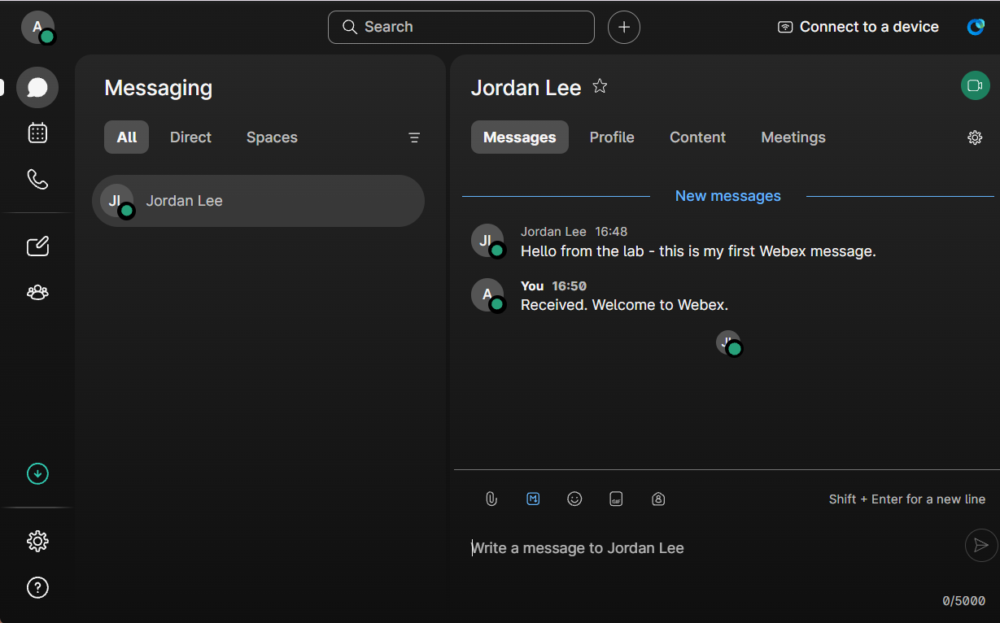
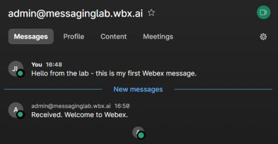
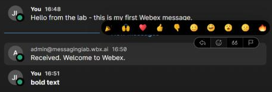
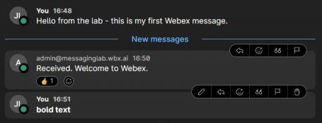
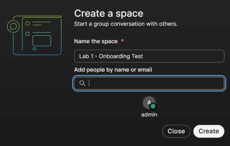
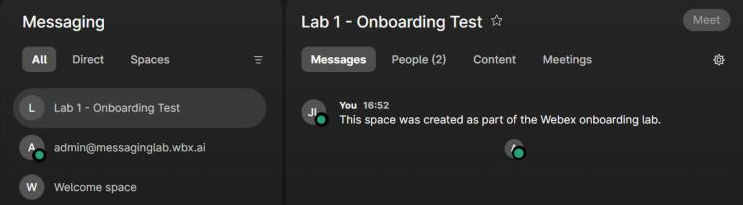

# Task 6 – Exchange Messages

<span class="task-badge">Task 6 of 7</span> &nbsp; **Estimated time:** 10 minutes

The licence is only proven by use. In this task you send a direct message, reply to it
from the other account, and then create a group space.

You will switch between two windows repeatedly:

- **Window A** — Webex App signed in as `<new-user-email>` (the new user)
- **Window B** — Webex App or [web.webex.com](https://web.webex.com) signed in as `<admin-email>`

!!! tip "Arrange your screen first"
    Put the two windows side by side before you start. Watching a message appear in
    real time on the other side is the entire point of this task. Window B must be a
    different browser, browser profile, or the desktop app — see the warning at the
    top of [Task 5](05-activate-signin.md).

!!! note "Screenshots are from the web app"
    Window A screenshots in this task were taken in the Webex web app
    ([web.webex.com](https://web.webex.com)). The desktop and mobile apps use similar
    menu names, but their layout and button positions differ.

!!! note "Your admin account needs Messaging too"
    Window B must be an account that is itself licensed for Messaging. Most
    administrator accounts are. If yours is not, assign yourself a Messaging license in
    Control Hub using the same steps as [Task 3](03-assign-license.md), or use any
    other licensed colleague as your conversation partner.

## Part 1 — Send a direct message

### Step 1 — Open Messaging

In **Window A** (the new user), click the **Messaging** icon (speech bubble) at the
top of the left-hand bar.

The list contains only the **Welcome space** that Webex created at first sign-in. That
is expected for a brand-new account.

### Step 2 — Start a conversation

Click the **+** button next to the **Search** bar at the top of the app and choose
**Send a direct message**.



### Step 3 — Address it

In the **Add people by name or email** field, type `<admin-email>`.

Webex searches your organization's directory as you type. Click the matching person in
the results.



!!! note "Why the directory lookup matters"
    The fact that your admin account appears in the new user's search results confirms
    both accounts are in the same Webex organization. If nobody is found, see
    [Troubleshooting](troubleshooting.md#cannot-find-the-other-user).

    An account with no display name set (common for the default admin of a trial
    organization) appears under its email address rather than a name.

### Step 4 — Send it

The conversation opens with a *"Say 'hi' to start chatting"* prompt. Click in the
message box at the bottom, type:

```text
Hello from the lab - this is my first Webex message.
```

Press ++enter++ to send. The message appears in the conversation, labelled **You**.



### Step 5 — Receive and reply

Switch to **Window B** (the admin).

A conversation with `<new-user-first> <new-user-last>` appears in the Messaging list,
usually within a second or two. Open it and reply:

```text
Received. Welcome to Webex.
```

Press ++enter++.



### Step 6 — Confirm the round trip

Switch back to **Window A**. The reply is visible in the conversation under a
**New messages** divider.



You have now proven the Messaging license works end to end.

## Part 2 — Try the formatting and reaction features

Still in **Window A**, in the same conversation, try each of these. They all exercise
the Messaging service rather than just plain text.

| Feature | How |
| --- | --- |
| **Markdown formatting** | Type `**bold text**` and send it. It renders bold. |
| **Reaction** | Hover over a received message and click the reaction (smiley) icon in the toolbar that appears, then pick a reaction. |
| **Edit** | Hover over one of your own messages and click the pencil (edit) icon, change the text, and save. |
| **Emoji** | Click the smiley button in the toolbar above the message box and pick one. |
| **File share** | Click the paperclip icon above the message box and send a small image or PDF. |





!!! tip "File sharing is part of Messaging"
    Shared files are stored in the conversation and listed under its **Content** tab.
    This is a licensed Messaging capability, not a separate service — a good thing to
    point out when explaining to a customer what their Messaging license includes.

## Part 3 — Create a group space

Direct messages are one-to-one. Spaces are persistent group conversations, and they are
the feature most people mean when they say "Webex."

### Step 1 — Create the space

In **Window A**, click the **+** button next to the **Search** bar and choose
**Create a space**.

### Step 2 — Name it

In **Name the space**, enter:

```text
Lab 1 - Onboarding Test
```

!!! tip "Naming matters more than it looks"
    A space name is how people find the conversation months later. Teach customers to
    name spaces after the topic or project, not after the people in it.

### Step 3 — Add people

In the **Add people by name or email** field, type `<admin-email>` and click the match.
The person appears below the field.

Add any other licensed colleague if you want a three-way conversation.



### Step 4 — Create

Click **Create**.

The space opens, and it appears immediately in the space list of everyone you added.

### Step 5 — Post to the space

Type and send:

```text
This space was created as part of the Webex onboarding lab.
```



The space header shows **People (2)** — you and the administrator.

### Step 6 — Confirm from the other side

Switch to **Window B**. The space **Lab 1 - Onboarding Test** appears in the admin's
space list with the unread message. Reply to it.

## :material-check-circle: Verify your work

- [ ] The new user sent a direct message that the admin received.
- [ ] The admin replied and the new user received the reply.
- [ ] You successfully used at least one of: emoji, formatting, reaction, edit, or file share.
- [ ] A space named `Lab 1 - Onboarding Test` exists and shows **People (2)** or more.
- [ ] Both accounts can post in that space.

!!! success "Lab objective met"
    A new user exists, is licensed for Messaging, is signed in, and is actively
    communicating. Everything from here is housekeeping.

---

[:material-arrow-left: Back: Task 5](05-activate-signin.md){ .md-button }
[Next: Task 7 – Clean Up :material-arrow-right:](07-cleanup.md){ .md-button .md-button--primary }
