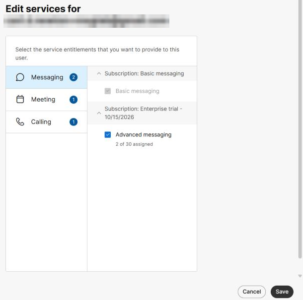
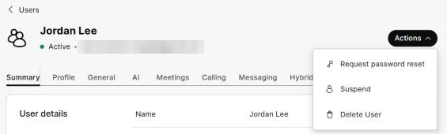
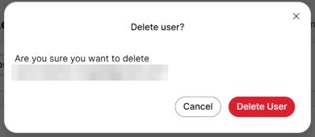

# Task 7 – Clean Up

Task 7 of 7 &nbsp; **Estimated time:** 5 minutes

The lab user is now consuming a Messaging license. This task shows you the ways to
give it back — which is also exactly what you do in production when somebody changes
role or leaves the company.

!!! warning "Decide before you act"
    Skip this task entirely if you are keeping the user for a later lab. Nothing
    breaks. Just be aware the license stays consumed.

## Choose your approach

| Approach | What happens to the account | What happens to their messages | Use it when |
| --- | --- | --- | --- |
| **A. Remove the license** | Account stays, keeps only the free Basic entitlements | Retained | The person is staying but changing role |
| **B. Suspend the user** | Account stays but the person cannot sign in | Retained | The person is leaving, but you must keep their data for now |
| **C. Delete the user** | Account removed from the organization | Removed from the organization's control | The person has left, or this was a lab account |

For a lab account you created only to practise, **C** is the tidy choice.

## Approach A — Remove the Advanced messaging license

### Step 1

In Control Hub, go to **Management > Users** and click the lab user.

### Step 2

On the **Summary** tab, scroll to **Licences** and click **Edit licences**.

An **Edit services** page opens with a read-only summary. Click **Edit licences** at
the bottom right to switch to the editable view.

### Step 3

With **Messaging** selected on the left, clear the **Advanced messaging** checkbox.

The free **Basic messaging** entitlement stays — the user can still do basic messaging,
but no longer holds a counted licence.

### Step 4

Click **Save**.

!!! note "The license returns to the pool"
    Check **Account > Subscriptions**. The assigned count for **Advanced messaging** has
    dropped by one and the license is available to assign to somebody else.

## Approach B — Suspend the user

In the user's profile, click **Actions** (top right) and choose **Suspend**. The account
and its data stay in place, but the person can no longer sign in.

## Approach C — Delete the user

!!! warning "This is not reversible"
    Deleting a user removes their account from your organization. Their messages and
    the files they shared are no longer accessible to them through this organization,
    and the account cannot be restored by recreating it with the same email — that
    creates a new, empty account.

    In production, confirm your organization's data-retention and legal-hold
    obligations before deleting anyone. Many organizations suspend rather than delete
    for this reason.

### Step 1

In Control Hub, go to **Management > Users** and click the lab user to open their
profile.

### Step 2

Click **Actions** at the top right of the profile and choose **Delete User**.

### Step 3

Control Hub asks *"Are you sure you want to delete `<new-user-email>`?"* Click
**Delete User** to confirm.

### Step 4

Verify the user no longer appears in the user list, and that
**Account > Subscriptions** shows the **Advanced messaging** license returned to the
available pool.

## Optional — Clean up the space

The space you created in Task 6 still exists for the remaining members.

In **Window B** (the admin), open **Lab 1 - Onboarding Test**, open the space menu, and
choose **Leave space**.

!!! note "Spaces outlive their members"
    A Webex space persists as long as at least one person is in it. Leaving a space
    removes it from your list but does not delete the conversation for anyone else.
    This surprises customers; it is worth calling out.

## :material-check-circle: Verify your work

- [ ] You chose and completed Approach A, B, or C (or deliberately skipped all three).
- [ ] **Account > Subscriptions** reflects the license change.
- [ ] You understand the difference between removing a license, suspending a user, and deleting a user.

---

## :material-trophy: Lab complete

You can now:

- Add a user to a Webex organization manually in Control Hub
- Assign and verify a Webex Messaging license
- Explain the Pending-to-Active lifecycle
- Activate a new account and sign in to the Webex App
- Exchange direct messages, use Messaging features, and create a space
- Reclaim a license, suspend a user, or remove a user

### Where to go next

- **Add Meetings.** Repeat Task 3 for the same user with a Meeting licence, then
  schedule and join a meeting.
- **Add Calling.** Assign a Webex Calling license, which introduces locations, phone
  numbers, and extensions.
- **Scale it up.** Instead of the manual wizard, use the bulk CSV option in
  **Management > Users** to add and license dozens of users at once.
- **Automate it.** The same operation is available over the
  [Webex People API](https://developer.webex.com/docs/api/v1/people), which is how
  real provisioning integrations do it.

---

[:material-arrow-left: Back: Task 6](06-exchange-messages.md){ .md-button }
[Troubleshooting :material-lifebuoy:](troubleshooting.md){ .md-button }
