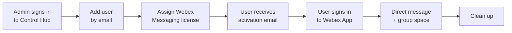

# Lab: Onboard a Messaging User in Webex

Beginner &nbsp; **Estimated time:** 35–45 minutes

## What you'll build

By the end of this lab, a brand-new person will exist in your Webex organization,
hold a Webex Messaging license, be signed in to the Webex App, and have exchanged
messages with you in both a direct conversation and a group space.

You will play two roles in this lab:

| Role | Who it is | What they do |
| --- | --- | --- |
| **Administrator** | You, in Control Hub | Create the user and assign the license |
| **New user** | A second mailbox / second device you control | Activates the account and sends messages |

!!! tip "You need two inboxes"
    This lab only works if you can read the new user's activation email. Before you
    start, decide what that second mailbox will be. See
    [Task 1](01-prerequisites.md) for options, including the email alias trick.

## Learning objectives

After completing this lab, you will be able to:

1. Sign in to Control Hub and locate the user management area.
2. Add a user to a Webex organization manually.
3. Assign and verify a Webex Messaging license.
4. Explain what the **Pending** user status means and when a license is consumed.
5. Activate a new Webex account and sign in to the Webex App.
6. Start a direct message, create a space, and exchange messages.
7. Remove a user or reclaim a license when the user leaves.

## Lab at a glance

## Tasks

| # | Task | Time |
| --- | --- | --- |
| 1 | [Prerequisites & Sign In to Control Hub](01-prerequisites.md) | 5 min |
| 2 | [Add the User](02-add-user.md) | 5 min |
| 3 | [Assign the Messaging License](03-assign-license.md) | 5 min |
| 4 | [Verify the User in Control Hub](04-verify-user.md) | 5 min |
| 5 | [Activate and Sign In to the Webex App](05-activate-signin.md) | 10 min |
| 6 | [Exchange Messages](06-exchange-messages.md) | 10 min |
| 7 | [Clean Up](07-cleanup.md) | 5 min |

If something goes wrong, jump to [Troubleshooting](troubleshooting.md).

---

!!! warning "Licenses are real"
    If you run this lab in a production organization, the Messaging license you assign
    is consumed from your real subscription the first time the new user signs in.
    [Task 7](07-cleanup.md) shows you how to give it back.
